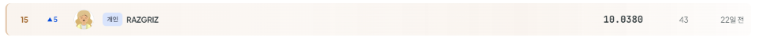
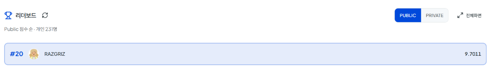
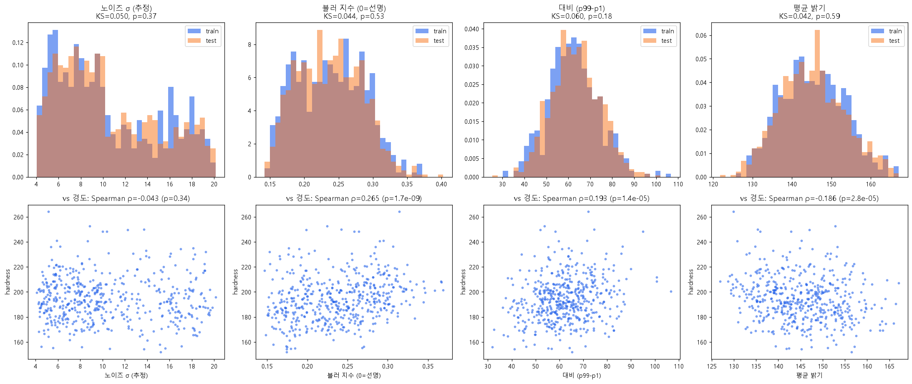
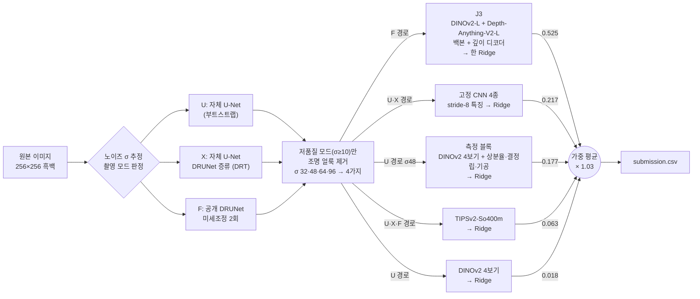

# 합성 미세구조 이미지 경도 예측 — 고정 사전학습 특징 + 학습형 디노이저 + Ridge

**DAKER 합성 미세구조 기반 재료 물성 예측 AI 경진대회**(2026.09.29 ~ 10.19, 개인 참가)


256×256 흑백 합성 미세구조 이미지 한 장으로 재료의 **경도를 예측하는 회귀** 과제입니다.
학습 이미지가 500장뿐이라 큰 모델을 미세조정하는 대신, **이미지를 깨끗하게 만드는 디노이저만 학습**하고
특징은 **고정(frozen)된 공개 사전학습 모델**에서 뽑아 **Ridge**로 회귀했습니다. 노트북 GPU(8GB) 한 장으로 진행했습니다.

| | Public (test 30%) | Private (test 70%, 최종 순위) |
|---|---|---|
| 첫 제출 (수작업 특징 + 미세조정 CNN) | 12.3256 | — |
| **최종 제출 (v32b)** | **9.7011 (20위)** | **10.0380 (15위 / 231명)** |

**Private 리더보드 (최종 순위)**



**Public 리더보드**



### 핵심 성과

- **데이터 생성기의 숨은 구조를 찾아 Public −0.9**: 노이즈가 큰 이미지(42%)가 블러·대비 감소·조명 얼룩까지 함께 가진
  별도의 촬영 모드라는 것을 파워 스펙트럼으로 분해했습니다. 학습형 디노이저와 저품질 모드 전용 조명 보정으로 처리해
  Public 11.32 → 10.39가 됐습니다.
- **미세조정 대신 고정 특징 + Ridge**: 공개 모델 30여 종을 같은 조건으로 비교해 소수만 골랐습니다.
  마지막에는 깊이 추정으로 다시 학습된 Depth-Anything-V2의 백본과 디코더를 DINOv2와 **한 Ridge에 결합**해 최종 성능을 냈습니다.
- **리더보드 잡음을 직접 계산하는 검증 체계**: 300장 Public 비교의 잡음을 두 제출의 예측 차이로 추정했습니다.
  상수 제출과 배율만 다른 제출로 **Public 점수 곡선을 정확히 계산**했고, 추정 9.759가 실제 9.7591로 맞았습니다.
- **Public 20위 → Private 15위**: 교차검증에서 생기는 선택 편향을 막는 채택 기준(폴드 일관성, 경도 구간 분해, 중첩 교차검증)을
  정해 지켰고, 과적합에 강한 구조를 끝까지 유지했습니다.

> 📊 [제출·실험 기록](docs/submission_log.csv) — 43번의 제출과 기각한 실험을 모두 적은 기록

> 📑 [EDA 보고서](reports/EDA_report.md) · [모델 선택](reports/model_selection.md) · [증강](reports/augmentation_report.md) · [앙상블 검토](reports/model_catalog_ensemble.md)

---

## 목차

1. [문제 정의](#1-문제-정의)
2. [데이터 분석](#2-데이터-분석)
3. [솔루션 구조](#3-솔루션-구조)
4. [핵심 기법](#4-핵심-기법)
5. [결과](#5-결과)
6. [주요 의사결정](#6-주요-의사결정)
7. [실패에서 배운 것](#7-실패에서-배운-것)
8. [회고](#8-회고)
9. [실행 방법](#9-실행-방법)
10. [재현성](#10-재현성)
11. [공개 범위](#11-공개-범위)

---

## 1. 문제 정의

| | |
|---|---|
| 과제 | 256×256 8bit 흑백 합성 미세구조 이미지 → 경도(HV 대리 지표) 회귀 |
| 평가 지표 | RMSE (Public: test 300장 / Private: test 700장) |
| 데이터 | train 500 / test 1,000 |
| 정답 분포 | train 평균 194.2, 표준편차 17.7 |
| 주요 규칙 | 외부 데이터 금지, **자체 생성(합성) 데이터 금지**, test는 추론에만 사용(pseudo-label 금지), 사전학습 모델은 대회 시작(2026-09-29) 전 공개된 허용 라이선스(MIT·Apache-2.0·CC-BY·CC-BY-NC)만 |
| 장비 | RTX 5060 Laptop 8GB (주력) / RTX 5060 Ti 16GB (일부 기간), Windows 11 |

```
(이미지 구성)  다각형 = 결정립, 얇고 어두운 선 = 결정립계, 더 어두운 결정립 = 2상, 검은 타원 = 기공
(가장 강한 신호) 2상 분율 (경도와 Spearman ρ = +0.58), 결정립 정렬도 (ρ = +0.40)
(목표)        이 구조로부터 경도 하나를 예측 (train 평균 194.2)
```

---

## 2. 데이터 분석

모델보다 데이터를 먼저 측정했고, 여기서 나온 세 가지가 전략을 정했습니다.

**① 이미지에 두 가지 촬영 모드가 섞여 있습니다.** 노이즈 σ≥10인 이미지(500장 중 209장, 42%)의 오차가 크게 높았습니다.
저노이즈 이미지에 같은 크기의 합성 노이즈를 입혀도 그만큼 나빠지지 않아 "노이즈만의 문제가 아니다"라고 판단했고,
파워 스펙트럼을 분석하니 이 모드에는 **가우시안 블러(σ≈1px), 대비 감소(약 0.77배), 조명 얼룩**이 함께 있었습니다.
이 발견이 디노이저와 조명 보정이라는 해법으로 이어졌습니다.

**② Public 정답 분포는 train보다 좁습니다.** train 평균만 낸 상수 제출과 평균+5 제출을 진단용으로 내서
Public 정답의 평균(≈194.5)과 표준편차(≈16.6)를 역산했습니다. train(17.7)보다 좁아서, train을 Public 분포에 맞게
재가중한 교차검증을 만들었고 이 지표가 이후 Public 변화를 잘 예측했습니다(예: 예측 11.77 → 실제 11.67).

**③ train과 test는 같은 분포입니다.** 노이즈·블러·대비·밝기 분포가 KS 검정으로 같았고(p 0.18~0.59),
PNG 메타데이터·파일 크기·ID 순서·근접 중복에서 누수도 없었습니다. 그래서 경도 10분위로 층화한 **고정 5-Fold OOF**를
모든 판단의 기준으로 삼았습니다.



---

## 3. 솔루션 구조



- **학습하는 것은 디노이저와 Ridge뿐**입니다. 특징 추출기(DINOv2, Depth-Anything, TIPSv2, ImageNet CNN)는 모두 고정했습니다.
- **디노이즈 경로**: U·X·F 세 경로 모두 D4 8방향 결과를 평균합니다. 공개 DRUNet 원본은 X·F 경로를 학습할 정답을 만드는 데 씁니다.
- **특징 풀링**: 특징맵을 평균·표준편차, 영역 간 불균일성(hetero3), 2상/기지 조건부 평균·표준편차로 요약합니다.
  보기에 따른 잡음을 줄이려고 D4 8방향 × 격자 이동 2 = **16보기**의 통계를 평균합니다.
- **Ridge**: 조명 보정 4가지 버전마다 따로 학습해 예측을 평균합니다. 벌점은 작은 고정값(`--alpha-rel 0.01`)이고,
  5-Fold OOF로 검증한 뒤 test 예측은 500장 전체로 다시 학습해 만듭니다.
- 모든 구성원의 OOF·test 예측을 CSV(`outputs/emb_reg/`)로 저장해 두면, 구성원 조합이나 가중치를 바꾸는 블렌드 실험을
  GPU 없이 **CPU에서 수 분 안에** 반복할 수 있습니다.

---

## 4. 핵심 기법

### 4-1. 학습형 디노이저 — 노이즈를 지우는 데만 학습을 쓴다

| 경로 | 만드는 방법 | 학습 데이터 |
|---|---|---|
| U | 자체 U-Net 학습 → 자기 출력을 정답으로 한 번 더 학습(부트스트랩) | 저노이즈 train 145장(σ<7) + 합성 가우시안 노이즈(σ 0~22) |
| X | 자체 U-Net을 공개 DRUNet이 정리한 이미지로 증류, 2회 | DRUNet이 정리한 고품질 train 291장(σ<10) + 합성 노이즈 |
| F | 공개 DRUNet(gray)을 같은 정답으로 미세조정, 2회 | 위와 같음 |

train 이미지에 가우시안 노이즈를 더하는 **증강만으로 학습**해 외부·합성 데이터 규칙을 지켰습니다.
디노이저(1차 + 부트스트랩)만으로 Public 11.32 → 10.57(−0.75)였고, 경로를 F까지 늘리며 9.90 → 9.78이 됐습니다.
반대로 저품질 이미지를 화소 단위로 합성해 재현하려던 시도는 실패했습니다. DINOv2 특징으로 합성본과 실제를 AUC 0.99로 구분할 수 있었습니다.

### 4-2. 저품질 모드만 조명 얼룩 제거

노이즈 σ≥10인 이미지에서만 가우시안 저역 성분(σ 32·48·64·96)을 빼서 조명 얼룩을 지웁니다.
보정 강도를 하나로 고르지 않고 **4가지 버전 각각으로 Ridge를 학습해 평균**했습니다. 보정 강도 선택에 따른 운을 줄이기 위해서입니다.
Public 10.57 → 10.45.

### 4-3. 고정 특징 + Ridge — 500장에서는 미세조정보다 강했다

CNN·ViT 미세조정, 자기지도 사전학습(SimCLR), DINOv2 LP-FT를 모두 시도했지만 고정 특징 + Ridge를 넘지 못했습니다.
고정 DINOv2로 바꾸자 Public이 한 번에 0.64 좋아졌고, 마지막에는 미세조정 CNN을 빼는 쪽이 오히려 좋았습니다(10.03 → 9.94).

후보 모델은 같은 조건(F 경로, 조명 보정 σ48, 8보기, 9~17층, Ridge)으로 단독 성능을 비교해 골랐습니다.

| 백본 (모두 고정) | 단독 OOF | 판정 |
|---|---|---|
| **Depth-Anything-V2-L** (DINOv2를 깊이 추정으로 재학습) | **10.059** | 채택 |
| DINOv2-L | 10.267 | 채택 |
| MoGe-1 / MoGe-2 (3차원 형상 추정) | 10.227 / 10.288 | 기각 (기존 조합에 더해도 무익) |
| Depth-Anything V1-L / V2 Metric Outdoor | 10.303 / 10.249 | 기각 |
| MiDaS DPT-Large | 11.780 | 기각 |

Ridge 벌점도 구성원마다 최적값을 고르는 것보다 **모두 작은 고정값**으로 두는 쪽이 블렌드에 좋았습니다(OOF 10.27 → 10.17).
평균이 분산을 줄여 주므로, 개별 구성원은 덜 규제해도 되기 때문입니다.

### 4-4. 도메인 지식을 넣은 풀링

특징맵을 평균·표준편차로만 요약하면 "어디에 무엇이 있는지"가 사라집니다.

- **영역 간 불균일성(hetero3)**: 이미지를 2×2·4×4·8×8 영역으로 나눠 영역 평균이 얼마나 다른지를 특징으로 넣었습니다. Public −0.26.
- **2상 조건부 풀링**: 어두운 2상 영역과 밝은 기지 영역에서 따로 평균·표준편차를 냈습니다. 상분율 특징과 함께 Public −0.08.

두 가지 모두 "경도는 상 분포와 불균일성에 좌우된다"는 재료 직관에서 출발했습니다.

### 4-5. 16보기 평균 — 특징의 측정 잡음 줄이기

같은 이미지를 회전·반전해서 넣으면 풀링 특징이 꽤 흔들렸습니다. 4방향 묶음을 무엇으로 고르느냐에 따라
OOF가 10.79~11.25로 달라졌고, 쓰던 묶음은 운 좋게 좋은 쪽이었습니다. 원인은 입력과 무관하게 위치에만 의존하는
DINOv2 토큰 성분이었습니다. 이 성분을 직접 빼면 오히려 나빠져서, 대신 **D4 8방향 × 격자 이동 2 = 16보기를 평균**했습니다.
4보기 모델과 16보기 모델은 Public 점수가 같으면서 틀리는 방식이 달라, 둘을 평균하자 Public이 10.29 → 10.23이 됐습니다.

### 4-6. 결합 Ridge — 따로 섞지 않고 한 모델 안에서 합치기

Depth-Anything 깊이 디코더(DPT neck, 32~256 격자 4단계) 특징은 단독으로는 약하고(11.7),
별도 구성원으로 블렌드에 넣어도 효과가 미미했습니다(중첩 교차검증 −0.014).
같은 특징을 DINOv2·Depth-Anything 백본 특징과 **한 Ridge 안에서 결합**(J3)하자, 구성원 단위로 0.10~0.16(조명 보정 4종 모두),
블렌드 중첩 교차검증으로 0.11 좋아졌습니다.

```
J3 = Ridge( [DINOv2-L 9~17층] ⊕ [Depth-Anything-V2-L 9~17층] ⊕ 0.3 × [깊이 디코더 4단계] )
```

반대로 이미 블렌드에 있는 구성원(CNN)과 같은 정보를 결합에 넣으면, 구성원은 좋아져도 블렌드는 나빠졌습니다.

---

## 5. 결과

| 제출 | 구성 (직전 행 대비 추가된 것) | CV (OOF) | Public | 증분 |
|---|---|---|---|---|
| v1 | 수작업 특징 Ridge + 미세조정 CNN 4종 | 13.13 | 12.326 | — |
| v4 | CNN 512 입력 | 12.77 | 12.317 | −0.01 |
| v6e | **고정 DINOv2 특징 + Ridge** | 12.41 | 11.674 | −0.64 |
| v9b | DINOv2 구성 확장 + 영역 불균일성 풀링 | 12.16 | 11.350 | −0.32 |
| v11b | 448 입력 + **학습형 디노이저** (1차 + 부트스트랩) | 11.42 | 10.567 | −0.78 |
| v12b | 저품질 모드 조명 보정 + test 예측을 500장 전체로 재학습 | 11.26 | 10.393 | −0.17 |
| v14c | 상분율 특징 + 2상 조건부 풀링 | 10.86 | 10.308 | −0.08 |
| v17b | DINOv2에 조건부 풀링 + 4보기·16보기 모델 평균 | 10.71 | 10.232 | −0.08 |
| v19a | TIPSv2 + 고정 CNN 얕은 층 | 10.62 | 10.068 | −0.16 |
| v22a | 고정 CNN 4종 결합, 미세조정 CNN 제거, 예측 폭 ×1.05 | 10.27 | 9.938 | −0.13 |
| v24a | 공개 DRUNet 디노이즈 경로 + 작은 고정 벌점 | 10.09 | 9.898 | −0.04 |
| v25a | 자체 U-Net 증류 경로 (X) | 10.00 | 9.830 | −0.07 |
| v26b | DRUNet 미세조정 경로 (F) | 9.89 | 9.778 | −0.05 |
| v28a | F 경로 DINOv2에 9층 추가 + 가중 재조정 | 9.80 | 9.759 | −0.02 |
| v29b | **Depth-Anything-V2-L 백본** | 9.74 | 9.719 | −0.04 |
| **v32b** | **결합 Ridge J3 (백본 + 깊이 디코더)** | **9.62** | **9.701** | **−0.02** |

**최종 제출은 v32b이고, Private 10.0380으로 231명 중 15위**입니다.
첫 제출 대비 Public 오차를 21% 줄였습니다. 전체 43번의 제출과 기각한 실험은 [`docs/submission_log.csv`](docs/submission_log.csv)에 있습니다.

> **예측 폭(배율) 선택** — Ridge는 예측을 평균 쪽으로 줄이는 경향이 있어 train 평균을 기준으로 예측 폭을 넓혔습니다.
> 상수 제출과 배율만 다른 두 제출로 계산한 Public 최적 배율은 0.98이었고(Public이 좁은 분포라서),
> test 전체가 train과 같다고 가정해 계산한 Private 최적 배율은 약 1.14였습니다. 최종 구성은 ×1.03(Public 9.7011)과 ×1.06(Public 9.7387) 두 가지로 만들었습니다.

---

## 6. 주요 의사결정

| 결정 | 근거 | 결과 |
|---|---|---|
| 미세조정 대신 고정 특징 + Ridge | CNN 미세조정의 CV 개선(13.13 → 12.77)이 Public에서 사라짐 (12.33 → 12.32) | 고정 DINOv2로 바꾸자 Public −0.64, 이후 모든 구성원의 기본 구조 |
| 오차가 몰린 저품질 모드를 먼저 분해 | σ≥10 이미지(42%)의 오차가 크고, 노이즈만으로는 설명되지 않음 | 디노이저 + 조명 보정으로 Public 11.32 → 10.39 |
| 자체 합성 데이터를 만들지 않음 | 시뮬레이터로 만든 이미지는 외부 데이터로 볼 수 있음 (규칙 해석, 운영진 답변으로 확인) | 디노이저도 train + 가우시안 노이즈 증강만으로 학습 |
| 측정 블록 비중을 0.18로 고정 | CV는 비중을 늘리라 했지만, Public에서 세 번 연속 이득이 없었음(빼면 오히려 좋아짐) | 이후 가중 재조정은 측정 블록을 고정하고 나머지만 적합 |
| 미세조정 CNN 제거 | CV는 도움이 된다고 했지만 Public에서 중립 | Public 10.03 → 9.94 |
| 앞쪽 층은 9층까지만 | 3~7층까지 넣은 판은 CV가 더 좋았지만 이득이 경도 양끝에 몰림 | 제출로 확인: 3~7층 판 Public +0.029 (기각) |
| 디코더를 별도 구성원 대신 결합 Ridge로 | 별도 구성원 −0.014, 결합 −0.11 (중첩 교차검증) | Public 9.719 → 9.701, 최종 구성 |
| 블렌드 가중치는 중첩 교차검증 적합값과 기존값의 중간 | 전체 OOF로 맞춘 가중치는 낙관적 | 재조정 이득 중 실제로 넘어오는 부분만 사용 |

---

## 7. 실패에서 배운 것

### CV는 좋아졌는데 리더보드는 그대로였습니다

| 제출 | 바꾼 것 | CV | Public |
|---|---|---|---|
| v1 | 수작업 특징 + 미세조정 CNN | 13.13 | 12.326 |
| v2 | 계열별 6블록 평균 | 13.03 | 12.335 |
| v3 | CNN 증강 개선, 3시드 | 12.99 | 12.365 |
| v4 | CNN 512 입력 | 12.77 | 12.317 |

처음 네 번의 제출에서 CV를 0.36 줄였지만 Public은 움직이지 않았습니다. 같은 종류의 모델 안에서 미세하게 고르는 개선은
test에서 사라졌고, **정보의 종류를 바꾸는 변화**(새 표현, 새 전처리)만 살아남았습니다.

### 경도 양끝에서만 좋아진 개선은 Public에서 사라졌습니다

| 변경 | CV에서 좋아진 곳 | Public |
|---|---|---|
| 저품질 특징 배율 1.5 (v20a) | −0.23, 전부 저품질 이미지의 경도 양끝 20% | +0.015 (기각) |
| 앞쪽 층 3~7 추가 (v28c) | OOF −0.013, 대부분 양끝 | +0.029 (기각) |
| 측정 블록 비중 확대 | CV 이득 0.19 (세 번 확인) | 빼면 오히려 좋아짐 |

Public 300장은 경도 분포가 좁아 양끝 표본이 적습니다. 그 뒤로는 모든 변경을 **경도 가운데 80%와 양끝 20%로 나눠** 보고,
가운데가 나빠지는 변경은 채택하지 않았습니다.

### '가장 좋았던 것'에는 운이 섞여 있었습니다

- DRUNet 미세조정에서 가장 좋았던 판은 같은 방법의 다른 시드보다 약 0.1 운이 좋았습니다(10.40 대 10.52).
- 디노이저 추론에 격자 이동 평균만 더했는데 단독 성능이 0.3 흔들렸습니다. 이 수준에서 CV 차이 0.05는 우연과 구분되지 않습니다.
- 그래서 **5개 폴드 중 5개에서 좋아졌는지**, **예측이 얼마나 크게 바뀌는지**(바뀔수록 더 강한 근거를 요구)를 채택 기준으로 썼습니다.

### Public 비교에도 잡음이 있습니다

두 제출의 Public 차이가 0.03이면 의미가 있을까요? 두 제출의 test 예측 차이로 비교 잡음을 추정해 보면,
예측 차이가 RMS 2.4일 때 Public 비교 잡음은 ±0.145, RMS 0.25일 때는 ±0.015 정도였습니다.
예측을 크게 바꾸는 실험은 Public 한 번으로 판정하지 않았습니다.

### Public과 Private는 다른 표본이었습니다

OOF 9.62, Public 9.70, Private 10.04로 Private가 가장 나빴습니다. 그래도 순위는 20위에서 15위로 올랐습니다.
이 모델은 경도 양끝의 오차가 커서(가운데 80%는 8.0, 양끝 20%는 14.3), Public보다 분포가 넓었을 Private에서 RMSE가 커지는 것은 자연스럽습니다.
다만 제출 직전에 "test 전체는 train과 같다"는 가정으로 추정한 Private(9.53~9.58)는 실제보다 낙관적이었습니다.
CV에서 출발한 추정은 **수백 번의 선택으로 생긴 CV의 낙관을 그대로 물려받는다**는 것을 확인했습니다.

### 효과가 없었던 시도

<details>
<summary>기각한 실험 목록 (펼치기)</summary>

| 분류 | 시도 |
|---|---|
| 학습 방식 | CNN·ViT 미세조정 확대, 자기지도 사전학습(SimCLR), DINOv2 LP-FT·도메인 적응, 타일(크롭) 학습 |
| 전처리 | 고전 디노이즈(TV·NLM), 디블러링(DPIR), 저품질 화소 합성 증강, 대비 보정, 디노이저 격자 이동 TTA, SCUNet 미세조정 |
| 표현 | DINOv2-g·reg4, MAE, I-JEPA, SigLIP, EVA02, SAM2, Perception Encoder, MoGe-1·2, MiDaS DPT, Depth-Anything V1·Metric, DPT-DINOv2 디코더 |
| 특징·풀링 | VLAD, 공간 자기상관, 2점 상관함수, 위상(오일러 특성) 특징, 결정립 분할 특징, 산란 변환 |
| 회귀·블렌드 | KRR·SVR·GP·TabICL, 촬영 모드별 모델·가중치, 잔차 보정 모델, 학습된 스태킹, 결합 Ridge에 겹치는 구성원 정보 추가 |

</details>

---

## 8. 회고

**잘한 것**
- 오차가 몰린 구간을 찾고 그 원인을 **물리적·통계적으로 분해**했습니다. 두 촬영 모드의 발견이 가장 큰 개선(디노이저, 조명 보정)으로 이어졌습니다.
- 무거운 특징 추출 결과와 구성원 예측을 파일로 저장해, 블렌드 실험을 CPU에서 수 분 안에 반복했습니다. 하루 수십 개 실험이 가능했던 이유입니다.
- 채택 기준(폴드 일관성, 경도 구간 분해, 중첩 교차검증, 예측 변화량)을 정하고 지켰습니다. Public에 맞추는 튜닝을 피한 덕분에 Private에서 순위가 올랐습니다.
- 사전학습 모델을 쓰기 전에 **라이선스와 공개일**을 확인했습니다. DINOv3처럼 자체 라이선스를 쓰는 모델은 성능과 무관하게 제외했습니다.

**아쉬운 것**
- 초반을 CNN 미세조정의 CV 튜닝에 썼습니다. 리더보드가 움직이지 않는 신호를 더 빨리 읽었어야 했습니다.
- Depth-Anything을 마감 하루 전에야 찾았습니다. 표현 후보를 초반에 더 넓게, 특히 깊이·기하 계열까지 탐색했어야 했습니다.
- 마지막 이틀의 변경(Depth-Anything, 결합 Ridge)을 재현 드라이버에 모두 반영하지 못했습니다.
- CV에서 출발한 Private 추정을 너무 믿었습니다. 실험 수가 많을수록 CV의 낙관도 커진다는 것을 수치로 보정하지 않았습니다.

**다음에 시도할 것**
1. 대회 초반에 표현 후보를 넓게 스캔 — 같은 조건, 같은 지표로 30분 안에 비교하는 틀을 먼저 만들기.
2. 평가한 구성 수를 기록하고, 많이 비교한 판단일수록 더 큰 개선을 요구하기.
3. 재현 파이프라인을 처음부터 함께 만들기 — 구성이 바뀔 때마다 드라이버를 갱신하는 대신, 구성 파일 하나로 관리.
4. 분포 가정에 의존하는 결정(예측 폭 등)은 Public과 train 분포 사이에서 보수적으로.

---

## 9. 실행 방법

### 9-1. 파일 구성

```
.
├── src/
│   ├── train_denoiser.py · denoise_with.py        ① 자체 U-Net 디노이저 학습·추론 (U·X 경로)
│   ├── drunet_finetune.py · drunet_denoise.py     ① 공개 DRUNet 미세조정·추론 (F 경로)
│   ├── flatfield_cache.py                         ② 저품질 모드 조명 얼룩 제거
│   ├── probe_models.py                            ③ 고정 사전학습 모델 특징 추출·풀링 (DINOv2·Depth-Anything·TIPSv2·CNN)
│   ├── phase_features.py · features_from_cache.py · smooth_cdf_features.py   ③ 측정 특징 (상분율·결정립·기공)
│   ├── multi_ridge.py                             ④ 구성원 Ridge (여러 특징 묶음을 한 Ridge에 결합)
│   ├── final_blend.py                             ⑤ 가중 평균 → 제출 파일
│   └── …                                          실험 모듈 (기각된 것 포함)
├── analysis/
│   ├── da_neck_embed.py                           ③ Depth-Anything 깊이 디코더 특징
│   ├── blend_eval.py · b30.py → … → b48_joint3.py 블렌드 평가 (구성원 교체·중첩 가중 적합)
│   └── …                                          실험 분석 스크립트 (기각된 것 포함)
├── experiments/                                   실험 실행 스크립트 — final_v32b.sh = 최종 구성
├── reproduce/                                     제출 재현 드라이버 run_final_v*.py (구성 변경 이력)
├── reports/                                       EDA·모델 선택·증강·앙상블 보고서
├── docs/                                          submission_log.csv (제출 43회 + 기각 실험), 리더보드 캡처
├── eda/ · bench/ · tools/                         EDA, GPU 벤치마크(노트북 vs Colab T4), 검증 도구
├── data/README.md · weights/README.md             데이터·가중치 준비 방법 (파일은 미포함)
├── requirements.txt
└── .gitignore
```

`analysis/`의 스크립트 이름은 실험 순서를 따른 것이라 짧습니다. 각 파일 첫 줄의 설명에 목적이 적혀 있습니다.

### 9-2. 환경

| | 실험 환경 |
|---|---|
| GPU | RTX 5060 Laptop 8GB (주력) / RTX 5060 Ti 16GB (일부 기간) |
| OS | Windows 11 |
| Python | 3.11.9 |
| PyTorch | 2.11.0+cu128 |
| timm / transformers | 1.0.30 / 5.19.0 |
| scikit-learn | 1.9.1 |

```bash
python -m venv .venv
.venv/Scripts/python -m pip install -r requirements.txt --extra-index-url https://download.pytorch.org/whl/cu128
```

> - **RTX 50 시리즈(Blackwell)** 는 CUDA 12.8(cu128) 빌드가 필요합니다.
> - 특징 추출은 bf16 autocast로 했습니다. VRAM 8GB에서 DINOv2-L·Depth-Anything-V2-L(448 입력, 배치 8) 추출이 가능합니다.
> - 사전학습 모델(DINOv2, Depth-Anything-V2, TIPSv2, ImageNet CNN)은 처음 실행할 때 Hugging Face Hub에서 내려받습니다.

### 9-3. 데이터 준비

대회 데이터는 재배포가 금지돼 포함하지 않습니다. 대회 페이지에서 받아 아래처럼 둡니다.

```
data/
├── train.csv               ID, hardness (500행)
├── sample_submission.csv   ID, hardness (1000행)
├── train/  TRAIN_000001.png ...
└── test/   TEST_000001.png ...
```

디노이저 가중치는 [`weights/README.md`](weights/README.md)를 참고하세요. 공개 DRUNet(gray)은 KAIR에서 내려받고,
자체 디노이저는 아래 `--mode train`으로 직접 학습할 수 있습니다.

### 9-4. 실행 순서

```bash
# ①~⑤ v29b 구성까지: 디노이저 → 조명 보정 → 특징 추출 → Ridge → 블렌드
#    드라이버는 자기 위치를 기준으로 src/를 찾으므로 저장소 루트로 복사해서 실행합니다.
#    단계별 산출물이 있으면 건너뛰므로, 중단돼도 같은 명령으로 이어서 실행됩니다.
cp reproduce/run_final_v29b.py run_final.py
python run_final.py --mode train      # 디노이저까지 처음부터 (전체 약 9~11시간, RTX 5060 Laptop 기준)
python run_final.py --mode infer      # 디노이저는 저장된 가중치로 추론만 (특징 추출·Ridge는 새로 계산)

# ⑥ 최종 구성(v32b): Depth-Anything 깊이 디코더 특징 + 결합 Ridge(J3) + 최종 블렌드
bash experiments/final_v32b.sh        # → submission/sub_v32b_k103.csv
```

- 두 모드 모두 공개 DRUNet(`weights/pretrained_denoiser/drunet_gray.pth`)이 필요합니다. `--mode infer`는 자체 디노이저 가중치 3개도 필요합니다([`weights/README.md`](weights/README.md)).
- `final_v32b.sh`는 위 드라이버가 만든 `outputs/` 산출물(F 경로 이미지, DINOv2 16보기 특징, 나머지 구성원 Ridge 결과)을 그대로 읽습니다.
  `PY` 환경변수로 파이썬 경로를 바꿀 수 있습니다(기본값 `./.venv/Scripts/python.exe`).
- 드라이버의 최종 블렌드(`submission/submission.csv`)는 v29b 구성이고, 최종 제출과 같은 파일은 `final_v32b.sh`가 만드는 `submission/sub_v32b_k103.csv`입니다.

### 9-5. 트러블슈팅

<details>
<summary>노트북 한 대 · Windows 환경에서 실제로 겪은 문제 8가지 (펼치기)</summary>

| 증상 | 원인 | 해결 |
|---|---|---|
| CNN 학습이 25배 느림 | Windows + RTX 5060에서 `channels_last` 형식의 BatchNorm 커널이 느림 | NCHW + bf16 autocast |
| GPU 전력이 45W에 묶여 학습이 1.5~5.5배 느림 | 노트북 기본 전원 모드 | 전용 충전기 + 제조사 Turbo 모드 → 109.5W |
| `joblib` 병렬 처리 실패 | 사용자 경로에 한글 포함 | `ProcessPoolExecutor`로 교체 |
| 특징 추출을 두 개 동시에 돌리면 둘 다 크게 느려짐 | 8GB VRAM 초과분이 시스템 RAM으로 넘어감 | GPU 작업은 큐로 하나씩 실행 |
| 추출 중 `CUDA error: unknown error` | 게임 등 다른 GPU 프로그램과 동시 실행 | GPU 작업 중 다른 GPU 프로그램 종료, 완료된 단계는 건너뛰고 재개 |
| 출력 폴더 생성 실패 | 모델 이름(`moge:...`)의 `:`가 Windows 파일 이름에 쓸 수 없는 문자 | 폴더 이름에서 `:` → `_` 치환 |
| CNN 미세조정 중 일부 폴드가 학습 실패 (train loss 0.94에서 멈춤), EfficientNet 발산 | 초반 학습 불안정 | 최종 train loss 기준 자동 재시도(`--retry-loss 0.8`), EfficientNet은 warmup 3에폭 |
| PC를 옮길 때 USB 복사 실패 | FAT32 파일당 4GB 제한 | 큰 특징 캐시는 선별 복사, 나머지는 다시 계산 |

</details>

---

## 10. 재현성

공개 전에 정리한 코드가 실제 대회 산출물을 재현하는지 확인했습니다.

| 확인 항목 | 결과 |
|---|---|
| `src/final_blend.py` ← 저장된 구성원 예측 → v32b 제출 파일 | OOF 9.619 일치, test 예측 최대 차이 0.016 (블렌드 가중치 반올림) |
| 같은 방식으로 v28a · v29b 제출 파일 | 최대 차이 0.013 · 0.007 |
| `reproduce/run_final_v19a.py` 새 폴더에서 처음부터 전체 실행 (10/13) | 제출 파일과 RMS 차이 0.158, 상관 0.99993 |
| 공개용 폴더 정리 후 평가 스크립트 재실행 | v32b OOF 9.619 그대로 |

**차이가 있는 부분도 있습니다.** 처음부터 끝까지 새 폴더에서 다시 실행하는 검증은 v19a 구성까지만 했습니다.
그 뒤에 추가한 DRUNet·DRT·미세조정 디노이즈 경로와 Depth-Anything 단계는 단계별로만 확인했습니다.
디노이저 학습에는 무작위성이 있어, 다시 학습하면 가중치가 같지 않고 최종 점수가 조금 달라질 수 있습니다.
GPU·torch 버전이 다르면 bf16 연산 차이로 예측이 소수점 첫째~둘째 자리에서 달라질 수 있습니다.

---

## 11. 공개 범위

- **포함**: 디노이저·조명 보정·특징 추출·Ridge·블렌드 코드, 실험 스크립트(기각된 것 포함), 보고서, 제출·실험 기록, 리더보드 캡처
- **제외**: 대회 데이터(이미지·CSV·설명 자료), 대회 이미지가 들어간 그림 4장, 모델 가중치(자체 디노이저 포함), 특징 캐시·구성원 예측, 제출 CSV, 개인 작업 노트

**사용한 사전학습 모델과 라이선스** — 모두 대회 시작일(2026-09-29) 전에 공개된 가중치이고, 특징 추출(추론)에만 사용했습니다. DRUNet만 예외로 미세조정했습니다.

| 모델 | 용도 | 라이선스 | 공개 |
|---|---|---|---|
| DINOv2-L/14 (`vit_large_patch14_dinov2.lvd142m`) | 고정 특징 | Apache-2.0 | 2023-04 |
| Depth-Anything-V2-Large (`depth-anything/Depth-Anything-V2-Large-hf`) | 고정 특징 (백본 + 깊이 디코더) | CC-BY-NC-4.0 | 2024-06 |
| TIPSv2-So400m (`vit_so400m_patch14_reg1_tipsv2.webli`) | 고정 특징 | Apache-2.0 | 2026-04 |
| DenseNet-121, DenseNetBlur-121d, ResNet-50 A1·A2 (timm) | 고정 특징 (stride-8 단계) | Apache-2.0 (timm 표기) | 2023 |
| DRUNet gray (KAIR) | 디노이즈 경로·미세조정 | MIT | 2021-09 |

이 저장소의 코드와 별개로, 위 모델 가중치에는 각자의 라이선스가 적용됩니다. 특히 Depth-Anything-V2-Large는 비상업적 이용만 허용됩니다.
대회 데이터와 제공 자료의 저작권은 주최측에 있습니다.
