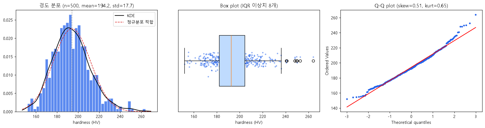
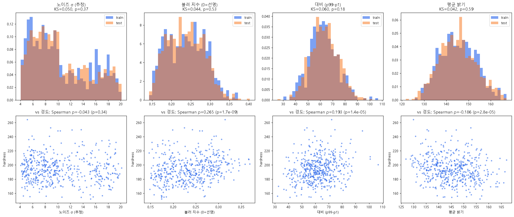
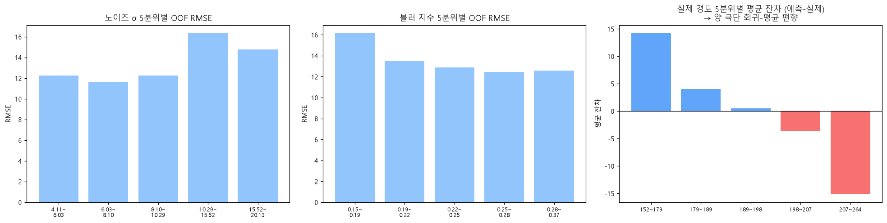
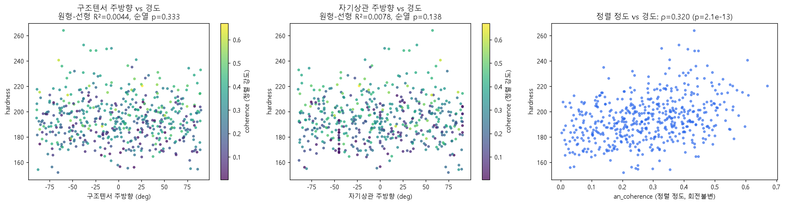
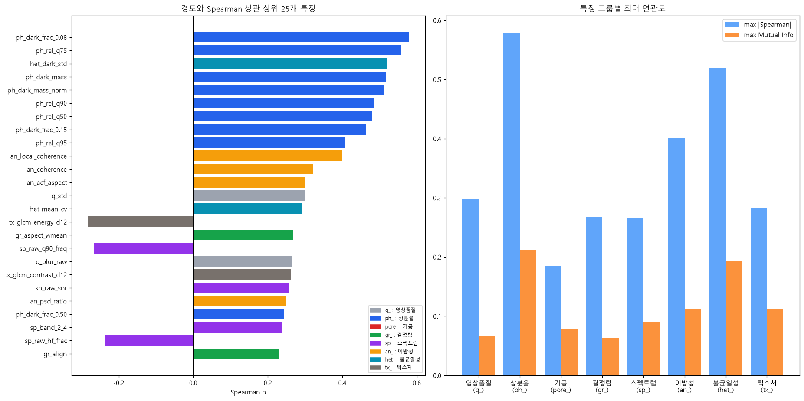
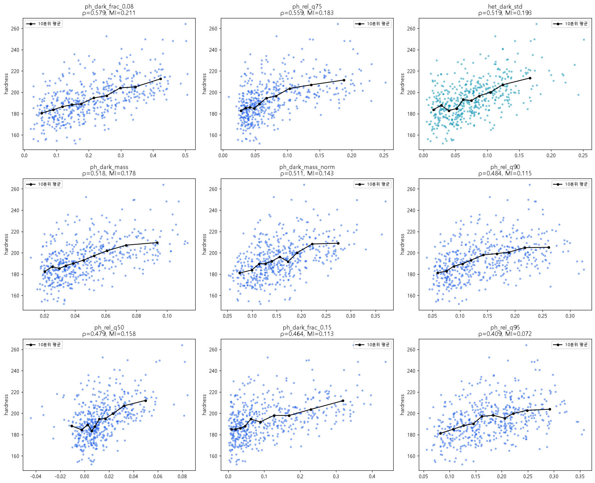
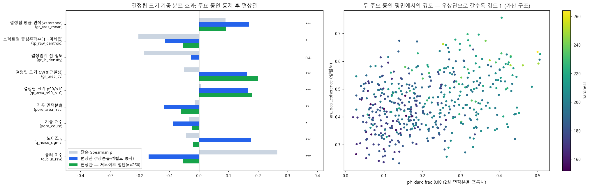
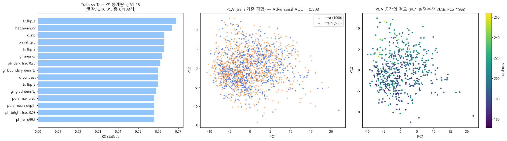
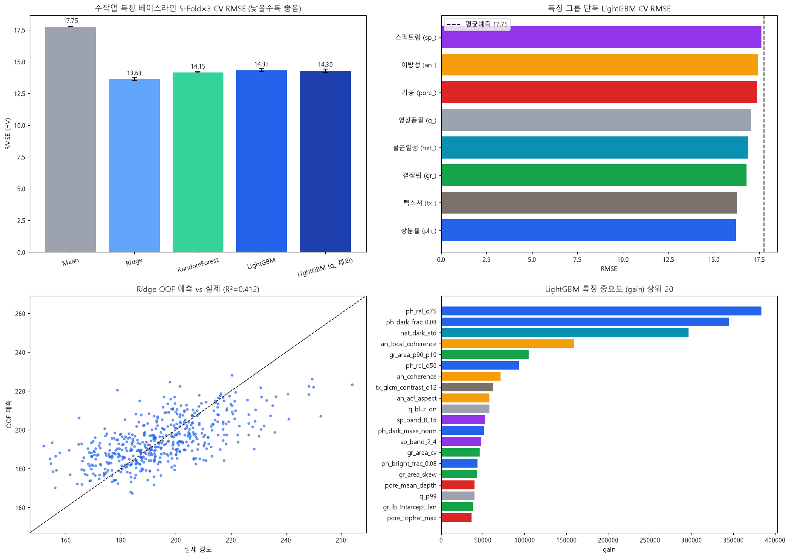

# 합성 미세구조 기반 재료 물성(경도) 예측 — EDA 보고서 & 모델 개발 계획

> 작성일: 2026-10-03 · 재현: `.venv/Scripts/python eda/run_eda.py` (특징 캐시 생성 시 약 3분)
> 모든 수치는 `reports/eda_summary.json`, `outputs/*.csv`에서 재생성됩니다.

---

## 0. 한 페이지 요약

| 항목 | 결과 | 모델링 시사점 |
|---|---|---|
| 데이터 | train 500장 / test 1,000장, 256×256 8-bit 그레이스케일, 결측·중복 없음 | 데이터가 매우 적음 → 사전학습 + 강한 정규화 + 증강 필수 |
| 타깃 | 평균 194.2, 표준편차 17.7, 152~264 HV, 우편향(skew 0.51), 상단 이상치 8개 | **평균 예측 RMSE = 17.68** (넘어야 할 최저선) |
| 가장 강한 신호 | **2상(어두운 결정립) 분율** ρ=+0.58, **결정립 정렬도** ρ=+0.40 | 면적분율·이방성을 정확히 "측정"하는 모델이 유리 |
| 보조 신호 | 결정립 크기 **불균일성(+)**, **기공(−)** — 주요 동인 통제 후 편상관 ±0.12~0.20 | 여러 요인이 **가산적으로 결합** (단일 그룹 RMSE ≥16.2 → 결합 13.6) |
| 결정립 크기 | Hall–Petch 방향 신호가 **관측되지 않음** (프록시 한계 또는 실제 기여 작음) | 수작업으로는 측정 곤란 → CNN이 학습하도록 위임 |
| 방향(각도) | 절대 방향은 경도와 **무관** (R²=0.004, 순열 p=0.33) | **회전·반전 증강 안전** / 단, 늘이기·전단은 정렬도를 바꾸므로 금지 |
| 영상 품질 | 노이즈 σ 4~20 **이봉 분포**(고노이즈 42%), 경도와 무관(ρ=−0.04) | 고노이즈에서 오차 +27% → 노이즈/블러 증강, 노이즈 강건 설계 |
| Train vs Test | Adversarial AUC **0.503**, KS 유의 특징 0/103개, 근접중복 없음 | CV를 신뢰 가능. Public LB(300장)의 RMSE 표본오차 ≈ **±0.56** |
| 수작업 특징 베이스라인 | **Ridge 13.63** ± 0.13 (R²=0.41) > RF 14.15 > LightGBM 14.33 | 측정 정확도가 병목. 극단값에서 ±15 HV 회귀-평균 편향 |

---

## 1. 대회 개요 (모델링 관점 요약)

- **과제**: 256×256 합성 미세구조 이미지 1장 → 경도 대용값(HV) 1개 회귀
- **평가**: RMSE (Public = test 30%, **Private = test 70%로 최종 순위**) → 2차: Private 상위 10명 코드·PPT 검증
- **일정**: 제출 마감 **2026-10-19 10:00 KST**, 코드·PPT 제출 10/19~10/22, 1일 최대 **5회** 제출, 개인 참가만 가능
- **규칙 중 모델링에 직접 영향을 주는 것**
  - **외부 데이터 사용 금지**: 제공된 train 외 데이터 불가
  - **test 데이터는 어떤 형태로도 학습 불가** → pseudo-labeling, test 기반 통계 적응 금지 (추론 시 TTA는 학습이 아니므로 가능)
  - 사전학습 모델은 **가중치가 공개되고 MIT/Apache 2.0/CC BY/CC BY-NC 등 허용 라이선스**인 것만 사용 가능
  - API형 모델(OpenAI, Gemini 등) 사용 불가, 로컬 실행 필수, Python만 사용
  - 제출 코드는 상대경로, UTF-8, 라이브러리 버전 명시, **Private Score 복원 가능**해야 함
- **주최 측 설명 자료의 힌트** (`미세구조_설명.pdf`)
  - 정답은 Hall–Petch, 상 혼합, 기공 영향 등 물리 경향을 **본떠 만든 합성값**. 단, "일반 경향이 그대로 적용되지 않을 수 있음"
  - 기공 효과는 "가정하지 말고 데이터로 학습", 불균일성은 "반드시 저경도라고 해석하지 말 것"
  - "이미지의 **절대 방향**과 **정렬 정도**는 구분해야 한다" → 방향 불변, 정렬도는 신호
  - "이미지의 물리적 길이 스케일은 제공하지 않음"

---

## 2. 데이터 개요

| 구분 | 개수 | 형식 | 비고 |
|---|---|---|---|
| train | 500 | PNG, L(8-bit), 256×256 | `train.csv`: `ID, hardness` |
| test | 1,000 | 동일 | `sample_submission.csv`: `ID, hardness` |

- 결측치 0, ID 중복 0. 대부분의 이미지는 0/255 포화 없이 중간 계조에 분포한다. 단 일부(최댓값 255인 이미지 18장, 최솟값 0인 이미지 13장 / 1,500장)는 고노이즈·고대비로 양 끝이 잘린다 → 입력 정규화는 이미지별 min-max가 아니라 **고정 스케일(/255)** 을 권장
- 이미지는 **보로노이형 다각형 결정립 + 얇고 어두운 결정립계 선 + 더 어두운 2상 결정립 + 검은 타원형 기공** 구조이며, 결정립이 임의 방향으로 신장된 경우가 많음

*(그림 `fig02_samples_by_hardness.png`: 대회 이미지가 포함되어 저장소에서 제외)*

*그림 2. 경도 최저/중앙/최고 그룹 샘플. 육안으로는 경도 순서가 잘 드러나지 않음 → 여러 요인이 섞여 있음.*

---

## 3. 타깃(hardness) 분석



| 통계 | 값 | 통계 | 값 |
|---|---|---|---|
| 평균 | 194.17 | 왜도 (원값 / log) | 0.51 / 0.20 |
| 표준편차 | 17.70 | 첨도 | 0.65 |
| 최솟값 / 5% | 151.98 / 168.62 | Shapiro p | 3.8e-5 (비정규) |
| 중앙값 | 192.55 | IQR 이상치 | 8개, **모두 상단** (240.7~264.1) |
| 95% / 최댓값 | 225.92 / 264.12 | 평균 예측 RMSE | **17.68** |

**해석**
- 하단은 152 근처에서 압축되고 상단 꼬리가 길다. log 변환 시 왜도가 0.51 → 0.20으로 줄어든다.
- 상단 이상치 8개는 측정오류라기보다 **여러 경화 요인이 동시에 큰 표본**일 가능성이 높다(합성 데이터). 제거하지 않고, 손실함수(MSE vs Huber)와 타깃 변환(원값 vs log)을 CV로 비교한다.
- RMSE는 큰 오차에 민감하므로 **상단 꼬리 예측력**이 순위에 큰 영향을 준다.

---

## 4. 특징 추출 방법

이미지 1장당 106개의 수작업 특징을 추출했다 (`src/features.py`). 이후 GBM/Ridge 모델과 하이브리드 모델에서 그대로 재사용한다.

*(그림 `fig05_feature_pipeline.png`: 대회 이미지가 포함되어 저장소에서 제외)*

*그림 5. ① 원본 → ② TV 디노이즈(결정립 = 구간별 상수 → Total Variation이 적합) → ③ closing(r=3)으로 결정립계 선 제거 후 기지 대비 상대 어둡기 → ④ 기공 검출 → ⑤ watershed 결정립 분할.*

| 그룹 | 접두어 | 주요 특징 | 신뢰도 |
|---|---|---|---|
| 영상 품질 | `q_` | 노이즈 σ(웨이블릿 추정), 블러 지수, 대비, 밝기 | 높음 |
| 상분율 | `ph_` | 상대 어둡기 >0.08/0.15/… 면적분율, 분위수 | 중상 (노이즈 영향 받음) |
| 기공 | `pore_` | top-hat 블롭 + "최암부 65% 이상" 필터 → 개수·면적·깊이 | 중 (정밀도↑ 재현율↓, 느슨한 후보도 함께 제공) |
| 결정립 | `gr_` | watershed 크기·종횡비·정렬, 크기 CV, 결정립계 선 밀도 | 저노이즈에서 중, 고노이즈에서 낮음 |
| 스펙트럼 | `sp_` | 파워스펙트럼 중심주파수(노이즈 바닥 제거), 자기상관 길이 | 중 |
| 이방성 | `an_` | 구조텐서 coherence(전역·국소), PSD/ACF 종횡비 | 높음 |
| 불균일성 | `het_` | 4×4 타일 간 밝기·어두운상·기울기 변동 | 중 |
| 텍스처 | `tx_` | GLCM(각도 평균 → 회전불변), LBP(회전불변 uniform) | 중 |
| nuisance | `nui_` | 주방향 각도 → **모델 입력에서 제외**, 분석에만 사용 | — |

**한계**: 미세 결정립 + 고노이즈 이미지에서는 TV 디노이즈가 결정립계를 지워 watershed가 실패한다. 원본 스펙트럼 기반 프록시(`sp_raw_*`)를 보완으로 넣었지만, 결정립 크기는 수작업으로 정확히 재기 어렵다.

---

## 5. 영상 품질(nuisance) 분석



| 지표 | Train 범위 | Train vs Test KS (p) | 경도와 Spearman ρ |
|---|---|---|---|
| 노이즈 σ | 4.1 ~ 20.1 | 0.050 (0.37) | **−0.043 (p=0.34, 무관)** |
| 블러 지수 | 0.15 ~ 0.37 | 0.044 (0.53) | +0.265 |
| 대비(p99−p1) | 32 ~ 107 | 0.060 (0.18) | +0.193 |
| 평균 밝기 | 127 ~ 167 | 0.042 (0.59) | −0.186 |

**해석**
- 노이즈 σ는 **이봉 분포**다: 저노이즈(σ≈4~10)와 고노이즈(σ≈10~20, train 41.8% / test 42.9%). 두 집단의 경도 평균은 같다(194.7 vs 193.4, t-검정 p=0.41). 즉 노이즈는 **순수 nuisance**다.
- 블러·대비·밝기의 상관은 콘텐츠 때문에 생긴 것으로 보인다. 예를 들어 2상이 많을수록 어두운 넓은 영역이 늘어 블러 지수와 대비가 커진다(블러–2상분율 ρ=0.61). 주요 동인을 통제하면 블러의 편상관은 저노이즈 집단에서 유의하지 않다(그림 13).
- **문제는 측정 오염**이다. 수작업 모델의 OOF RMSE는 저노이즈 12.07, 고노이즈 **15.31**(+27%)이다.



*그림 12. 고노이즈(σ>10) 구간에서 오차가 크다(블러 지수가 낮은 구간 = 노이즈로 "선명하게" 보이는 이미지). 오른쪽: 극단 경도에서 ±15 HV 회귀-평균 편향.*

→ 모델링 시사점: **노이즈·블러·대비 증강**으로 품질 불변성을 학습시키고, 고노이즈 집단의 오차를 별도 지표로 추적한다.

---

## 6. 방향 불변성 검증 (증강 정당성)



- 주방향 각도 θ로 경도를 회귀(cos2θ, sin2θ)하면 R²=0.0044(순열 p=0.33), ACF 기준 R²=0.0078(p=0.14). **절대 방향은 경도와 무관**하다.
- 반면 **정렬 정도**(coherence)는 ρ=+0.32, 국소 coherence는 ρ=+0.40으로 유의하다(p<1e-12).

→ **회전(90° 배수 + 임의 각도)·좌우/상하 반전은 레이블을 보존하는 증강**이다. 추론 시 D4 8방향 TTA도 정당하다.
→ 반대로 **비등방 스케일, 전단, 탄성 변형은 정렬도와 결정립 형상을 바꾸므로 금지**한다. 등방 줌도 결정립 크기 정보를 왜곡할 수 있어 기본은 사용하지 않는다(실험으로 확인).

---

## 7. 특징–경도 관계



**상위 상관 특징** (103개 중 52개가 p<0.001)

| 순위 | 특징 | 의미 | Spearman ρ | MI |
|---|---|---|---|---|
| 1 | `ph_dark_frac_0.08` | 기지보다 8% 이상 어두운 면적 (2상+기공) | **+0.579** | 0.211 |
| 2 | `ph_rel_q75` | 상대 어둡기 75% 분위 | +0.559 | 0.183 |
| 3 | `het_dark_std` | 타일 간 어두운상 분율 편차 | +0.519 | 0.193 |
| 4 | `ph_dark_mass` | 어두운 정도의 총량 | +0.518 | 0.178 |
| 10 | `an_local_coherence` | 국소 정렬도 | **+0.401** | 0.112 |
| 11 | `an_coherence` | 전역 정렬도 | +0.320 | 0.069 |
| 16 | `gr_aspect_wmean` | 결정립 종횡비(면적가중) | +0.267 | 0.014 |



*그림 7. 상위 9개 특징 산점도(검은선 = 10분위 평균). 관계는 대체로 단조·준선형이지만 산포가 크다. 단일 특징으로는 설명력이 제한적이다.*

### 7.1 편상관: 주요 동인 통제 후 남는 효과



2상 분율과 정렬도를 통제하고 다른 요인의 **순수 효과**를 분리했다.

| 요인 | 단순 ρ | 편상관 (전체) | 편상관 (저노이즈 절반) | 해석 |
|---|---|---|---|---|
| 결정립 크기 CV (불균일성) | −0.05 | **+0.16** *** | **+0.20** ** | 불균일할수록 경도↑ (PDF 힌트와 일치) |
| 결정립 크기 p90/p10 | +0.01 | +0.17 *** | +0.18 ** | 위와 동일 |
| 기공 면적분율 | −0.01 | **−0.12** ** | −0.06 n.s. | 기공↑ → 경도↓ (약함) |
| 결정립 평균 면적 | +0.09 | +0.17 *** | +0.09 n.s. | **Hall–Petch와 반대 방향 또는 무관** |
| 스펙트럼 중심주파수 (↑=미세립) | −0.20 | −0.12 * | −0.06 n.s. | 위와 동일 |
| 노이즈 σ | −0.04 | +0.18 *** | −0.02 n.s. | 통제변수(2상분율)가 노이즈에 오염되어 생긴 **측정 인공물** |

**결정립 크기에 대한 해석 (가설)**: Hall–Petch(미세립 → 고경도) 신호가 보이지 않는다. 가능한 원인은 ① 수작업 프록시의 측정 한계(특히 고노이즈 미세립), ② 이미지마다 물리 스케일(배율)이 달라 픽셀 크기와 실제 크기가 일치하지 않음(PDF: "물리적 길이 스케일 비제공"), ③ 합성 공식에서의 기여가 작음이다. 현 단계에서는 결론을 내리지 않고 CNN이 직접 학습하도록 둔다. CNN 학습 후 Grad-CAM이나 특징 회귀로 재검증한다.

### 7.2 가산 구조

- 특징 그룹 하나만으로 LightGBM을 학습하면 RMSE 16.2~17.6에 그친다(그림 11 우상단). 전체를 결합하면 13.6이다. → **여러 미세구조 요인이 더해져 경도가 결정되는 구조**다.
- 그림 13 오른쪽: (2상 분율, 정렬도) 평면에서 우상단으로 갈수록 경도가 높아진다.
- 상위 특징끼리는 강한 다중공선성이 있다(그림 8: 상위 `ph_*`·`het_dark_std` 특징 쌍별 |ρ| 중앙값 0.87, 범위 0.68~0.98). Ridge가 GBM보다 좋은 이유 중 하나다(작은 데이터 + 준선형 관계 + 공선성).

---

## 8. Train/Test 분포 비교 & 중복 검사



- **Adversarial validation AUC = 0.503**: train과 test를 구분하지 못한다(완전 동일 분포에 해당).
- 103개 특징 KS 검정에서 p<0.01인 특징은 **0개**다(최대 KS=0.069).
- 32×32 썸네일 정규화 상관을 D4 8방향 변환까지 포함해 비교했다. test→train 최대 0.73, train→train 최대 0.70이며 **0.9를 넘는 근접 중복은 없다**(그림 10).

→ 누수나 분포 이동 위험이 낮다. **로컬 CV를 1차 의사결정 기준**으로 삼는다.
→ Public LB는 300장이므로 RMSE≈13 기준 표본오차가 약 **±0.56**이다(Private 700장 ±0.36, CV 500장 ±0.43). Public 점수 0.5 미만의 차이로 모델을 고르면 과적합(shake-up) 위험이 있다.

---

## 9. 수작업 특징 베이스라인 (5-Fold × 3회 반복 CV)



| 모델 | CV RMSE | 비고 |
|---|---|---|
| 평균 예측 | 17.75 ± 0.02 | 최저선 |
| **Ridge** (표준화 + α CV) | **13.63 ± 0.13** | R²=0.41, 최고 |
| RandomForest | 14.15 ± 0.05 | |
| LightGBM | 14.33 ± 0.11 | |
| LightGBM (영상품질 `q_` 제외) | 14.30 ± 0.13 | 품질 특징은 거의 기여 없음 → 누수 신호 없음 |

**오차 특성**
- 예측 표준편차 11.5 vs 실제 17.7. 예측이 평균 쪽으로 압축되어 하위 20%는 +14.2, 상위 20%는 −15.1 편향이 있다. 정보가 부족한 모델의 전형적인 회귀-평균 현상이다.
- 특징 중요도 상위: `ph_rel_q75`, `ph_dark_frac_0.08`, `het_dark_std`, `an_local_coherence`, `gr_area_p90_p10`

---

## 10. 핵심 인사이트 → 모델링 결정

| # | 인사이트 | 결정 |
|---|---|---|
| 1 | 2상 분율·정렬도·불균일성·기공이 가산적으로 경도를 결정 | 이 요인들을 정밀하게 "측정"하는 표현이 필요 → **CNN 주력 + 수작업 특징 보조** |
| 2 | 수작업 측정이 노이즈에 오염 (고노이즈 오차 +27%) | 학습 기반 특징(CNN)이 측정 정확도를 크게 끌어올릴 여지가 있음 |
| 3 | 절대 방향 무관, 정렬도는 신호 | **D4 + 임의 회전 증강, D4 TTA** / 비등방 변형·전단 금지 |
| 4 | 노이즈 σ 이봉 분포, 경도와 무관 | **노이즈(σ 4~20)·블러·약한 대비 증강**, 노이즈 집단별 CV 추적 |
| 5 | Train≈Test, 중복 없음 | 로컬 CV 신뢰, LB는 보조 지표 (±0.56) |
| 6 | 500장으로 소규모, 공선성 큼 | 사전학습 백본 + 강한 정규화, 멀티시드·K-fold 앙상블 |
| 7 | 우편향 타깃, 상단 이상치 | MSE vs Huber, 원값 vs log 타깃 CV 비교, 고경도 구간 오차 추적 |
| 8 | 결정립 크기 효과 불명확 | **해상도 축소(다운샘플) 금지** — 미세 결정립계 정보 보존을 위해 256 원해상도 입력 |

---

## 11. AI 모델 개발 계획

### 11.1 전체 로드맵 (D-16, 마감 10/19 10:00)

```
10/03 (토)  ✅ EDA, 특징 모듈, 베이스라인 13.63
10/04~05   ① 검증 프레임워크 고정 + 첫 제출(LB–CV 정합 확인) + PyTorch(GPU) 환경
10/06~10   ② CNN 단일 모델 실험: 백본·손실·증강·해상도 → 최적 레시피
10/11~14   ③ 다양성 확보: 백본 2~3종 × 멀티시드, 하이브리드(CNN 임베딩 + 수작업 특징)
10/15~17   ④ 앙상블/스태킹 (OOF 기반), 최종 후보 2개 선정, 재현 스크립트 정리
10/18~19   ⑤ 최종 제출 (CV 최상 + 안정형), 버전·환경 기록
10/19~22   ⑥ (Private 상위 10위 시) 코드 + PPT(PDF) 제출
```

### 11.2 검증 전략 (모든 실험의 공통 규약)

- **5-Fold**: 경도 10분위로 층화한 KFold, 시드 3개 반복. 폴드는 `outputs/folds.csv`로 **고정해 모든 모델이 공유**한다(스태킹 시 누수 방지).
- **지표**: OOF RMSE(주), 노이즈 집단별 RMSE, 경도 5분위별 편향(보조)
- **LB 활용 원칙**: 하루 5회 제출 중 1~2회만 사용해 CV–LB 정합을 확인한다. 0.5 미만 차이로는 의사결정하지 않는다.
- **test 사용 금지 준수**: test는 추론에만 사용한다(정규화 통계, pseudo-label, BN 적응 등 일체 금지).

### 11.3 모델 트랙

| 트랙 | 내용 | 기대 역할 |
|---|---|---|
| **A. 수작업 특징 모델** | 현재 106개 특징 → Ridge / SVR / GBM / GP. 특징 개선(다중 스케일 결정립 측정, 2상 면적분율 정밀화) | 빠르고 해석 가능, 앙상블 다양성 |
| **B. CNN 미세조정 (주력)** | ImageNet 사전학습 백본(허용 라이선스) 회귀 미세조정. 256 원해상도, 1채널→3채널 복제, 표준화 타깃, AdamW + cosine, 5-fold | 측정 정확도 향상 → 핵심 성능원 |
| **C. 하이브리드** | CNN 임베딩(GAP 출력) + 수작업 특징 → Ridge/GBM, 또는 특징을 CNN 헤드에 결합 | 두 정보원 결합 |
| **D. 앙상블/스태킹** | 고정 폴드 OOF로 가중치 최적화(비음수 선형 / Ridge 스태킹) | 분산 감소, 최종 제출 |

> 구체적인 백본 후보 선정과 비교는 **다음 단계(2번: 모델 선택)** 에서 진행한다.

### 11.4 증강 전략 (EDA 근거 기반)

| 분류 | 증강 | 근거 |
|---|---|---|
| ✅ 안전 | 좌우·상하 반전, 90° 회전(D4 8종) | 방향 무관 검증 (R²=0.004) |
| ✅ 안전 | 임의 각도 회전 (reflect 패딩) | 동일. 단 모서리 보간 영향은 실험으로 확인 |
| ✅ 권장 | 가우시안 노이즈(σ 4~20), 가우시안 블러, 약한 밝기/대비 | 품질은 경도와 무관, 고노이즈 오차 감소 목적 |
| ⚠️ 실험 | 랜덤 크롭/평행이동 | 시야가 줄면 분율 추정 분산이 증가할 수 있음 |
| ❌ 금지 | 비등방 스케일, 전단, 탄성 변형 | 정렬도·결정립 형상(경도 신호)을 변경 |
| ❌ 금지 | 등방 줌(기본) | 결정립 크기 정보 왜곡 가능 |
| ❌ 금지 | Mixup/CutMix | 이미지 혼합 ≠ 경도의 선형 혼합 |
| ✅ 추론 | D4 TTA 평균 | 학습이 아니므로 규칙상 문제 없음 |

### 11.5 규칙 준수 체크 (3단계 "추가 데이터" 관련 선행 검토)

- ❗ **공공데이터 등 외부 데이터 추가는 대회 규칙상 금지**다("제공하는 학습 데이터(train) 외의 외부 데이터는 사용 불가"). 위반 시 실격될 수 있으므로 3단계는 **train 기반 증강 데이터 생성**에 집중하는 것을 권장한다.
- 직접 만든 합성 이미지(보로노이 시뮬레이터 등)도 "외부 데이터"로 해석될 소지가 있다. 사용하려면 **대회 게시판에 공식 문의**해 답변을 받은 뒤 결정한다.
- 사전학습 가중치는 모델별 **라이선스를 기록**한다(PPT·코드 검증 대비).

### 11.6 리스크 & 대응

| 리스크 | 대응 |
|---|---|
| 500장 과적합 | 사전학습 + 증강 + 조기종료 + K-fold·멀티시드 평균 |
| Public LB 과적합 (300장) | CV 기준 선택, 최종 2개 중 1개는 "CV 안정형" |
| 고노이즈 이미지 성능 저하 | 노이즈 증강, 집단별 지표 모니터링, 필요 시 디노이즈 채널 추가 입력 |
| GPU (RTX 5060 Laptop 8GB, Blackwell) 호환 | PyTorch CUDA 12.8 빌드 설치 필요, 배치·AMP로 메모리 관리 |
| 재현성 (2차 검증) | 시드 고정, 상대경로, `requirements.txt`, 학습→추론 단일 스크립트 |

---

## 부록 A. 산출물 구조

```
├─ data/                         # 원본 (train/, test/, train.csv, sample_submission.csv)
├─ src/features.py               # 수작업 특징 추출 모듈 (재사용)
├─ eda/run_eda.py                # EDA 전체 파이프라인
├─ outputs/
│   ├─ features/{train,test}_features.csv   # 106개 특징 캐시
│   ├─ feature_target_correlation.csv       # 특징별 Spearman/Pearson/MI
│   └─ partial_correlation.csv              # 편상관 결과
├─ reports/
│   ├─ EDA_report.md             # 본 문서
│   ├─ eda_summary.json          # 핵심 수치
│   └─ figures/fig01~fig13.png
└─ requirements.txt              # Python 3.11.9 기준 버전 고정
```

## 부록 B. 재현 방법

```bash
python -m venv .venv
.venv/Scripts/python -m pip install -r requirements.txt
.venv/Scripts/python eda/run_eda.py
```
- 환경: Windows 11, Python 3.11.9, CPU 병렬(ProcessPool) 특징 추출 약 3분
- 참고: 사용자 경로에 한글이 포함되면 joblib(loky) 병렬이 실패하므로 표준 `ProcessPoolExecutor`를 사용함
