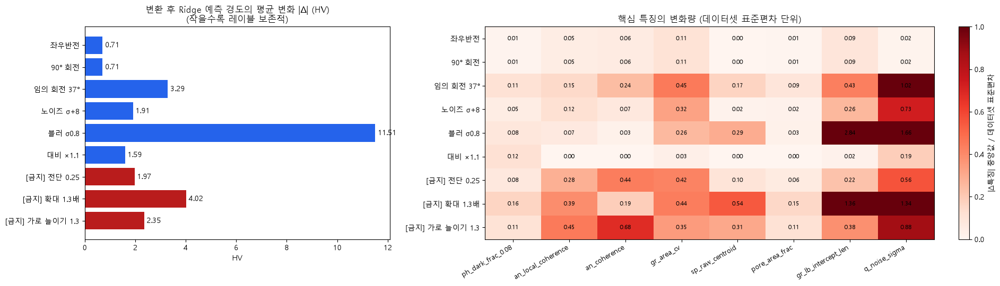

# 3단계 — 데이터 증강 & 추가 데이터 검토 보고서

> 작성일: 2026-10-04 · 코드: `src/train_cnn.py`(GPU 온라인 증강), `src/aug_invariance.py`(레이블 보존성 검사), `experiments/aug_*.sh`
> 평가: 고정 5-Fold OOF RMSE (ResNet-18 테스트베드, 시드 2~3개), 낮을수록 좋음

---

## 0. 요약

| 항목 | 결론 |
|---|---|
| 추가 데이터(공공데이터) | **사용 불가** — 대회 규칙 "train 외 외부 데이터 사용 불가". 자체 합성 데이터도 해석 여지가 있어 **게시판 공식 답변 전에는 사용하지 않음** (§1) |
| 증강 방식 | 파일로 미리 만드는 **오프라인 증강 대신, 학습 중 GPU에서 매번 새로 만드는 온라인 증강** (§2) |
| 레이블 보존 검증 | 반전·90° 회전은 핵심 특징 변화 ≤0.11 SD로 **보존**. 전단·늘이기는 정렬도를, 확대는 결정립 크기를 바꿔 **금지** (§3) |
| 가장 효과적인 증강 | **노이즈 강화(σ≤8 → σ≤16): −0.28**, 임의 각도 회전: −0.15 (§4) |
| 최종 레시피 | `--rot-p 0.5 --noise 16` + 기존 D4·블러·대비 (§4.3) |
| 최종 성과 | 새 레시피 × 3시드로 CNN 블록 **13.18~13.39**(이전 13.73~13.98), 앙상블 OOF **12.99** → 제출 후보 `sub_v3_cnn_heavy.csv` (§6) |
| 덤으로 해결한 문제 | EfficientNet-B0 발산: **warmup 3에폭**으로 13.98 → 13.58 / 간헐적 학습 실패: **학습 손실 기반 자동 재시도** (§5) |

---

## 1. 추가 데이터 검토 (규칙 준수)

### 1.1 규칙 원문 (대회 페이지 [규칙])

> 3) 외부 데이터 사용 금지 — 본 경진대회에서 제공하는 학습 데이터(train) 외의 외부 데이터는 사용 불가합니다. 단, 제공하는 평가 데이터(test)는 어떠한 형태로도 모델 학습에 활용할 수 없습니다.

### 1.2 데이터 출처별 판단

| 데이터 출처 | 판단 | 근거 |
|---|---|---|
| 공공 미세구조 데이터셋 (예: 실제 금속 현미경 이미지) | ❌ **금지** | 명백한 외부 데이터 |
| test 이미지 (pseudo-label, 자기지도 사전학습, 정규화 통계 등) | ❌ **금지** | "어떠한 형태로도" 학습 활용 불가 |
| train 이미지의 변환(반전·회전·노이즈 등) = 증강 | ✅ 허용 | train 데이터 자체의 가공 |
| 사전학습 모델 가중치 (ImageNet, DINOv2 등) | ✅ 허용 | 규칙 1)에서 허용 라이선스 모델 명시적 허용 — **외부 지식은 이 경로로만 활용** |
| 직접 만든 시뮬레이터로 생성한 합성 미세구조 이미지 | ⚠️ **불명확** | "train 외 데이터"로 해석될 소지. 실격 위험 대비 **게시판 문의 후 결정** |

### 1.3 게시판 문의 초안 (필요 시 사용)

> 제목: 학습 데이터 증강 범위 문의
> 안녕하세요. 제공된 train 이미지에 반전·회전·노이즈 추가 등의 변환을 적용하는 증강은 허용되는 것으로 이해하고 있습니다.
> 추가로, 외부 데이터를 전혀 사용하지 않고 참가자가 직접 작성한 코드(예: 보로노이 분할)로 생성한 합성 미세구조 이미지를 학습(예: 사전학습)에 사용하는 것이 "외부 데이터"에 해당하는지 문의드립니다. 이 경우 정답(경도)은 사용하지 않습니다.

> 현재 판단: 합성 시뮬레이터는 구현 비용이 크고, 실제 생성 규칙(경도 공식)을 모르므로 효과도 불확실하다. **우선순위 낮음**.

---

## 2. 증강 설계

### 2.1 온라인 증강을 택한 이유

| 방식 | 장점 | 단점 |
|---|---|---|
| 오프라인 (증강 이미지를 파일로 N배 저장) | 눈으로 확인 쉬움 | 변형 종류가 고정됨(N개), 디스크 사용, 폴드 간 누수 위험(같은 원본의 변형이 train/val에 갈라질 수 있음) |
| **온라인 (학습 중 매 배치마다 무작위 생성)** | 매 에폭 새로운 변형 → 사실상 무한 증강, 폴드 누수 없음, GPU에서 처리해 추가 시간 거의 없음 | 눈으로 보려면 별도 시각화 필요 → `fig_aug_examples.png` |

### 2.2 적용 순서 (`src/train_cnn.py::augment`, 배치 단위·GPU)

```
원본(0~1) → ① D4: 8가지 반전·90°회전 중 무작위 → ② 임의 각도 회전(확률 p, reflection 패딩)
        → ③ 가우시안 블러(p=0.25, σ 0.3~1.0) → ④ 밝기 ±3%·대비 ±10% → ⑤ 가우시안 노이즈(σ 0~σmax) → clamp
추론: D4 8방향 TTA 평균
```

*(그림 `fig_aug_examples.png`: 대회 이미지가 포함되어 저장소에서 제외)*

*증강 변환 예시. 빨간 [금지] 항목은 결정립 크기·형상·정렬도를 바꾸므로 사용하지 않는다.*

---

## 3. 레이블 보존성 검증

train 60장에 각 변환을 적용하고 **수작업 특징의 변화량**(데이터셋 표준편차 단위)과 **Ridge 예측 경도의 변화**를 측정했다.



| 변환 | 예측 변화 (HV) | 핵심 구조 특징 변화 (SD) | 판정 |
|---|---|---|---|
| 좌우반전 / 90° 회전 | 0.71 | 모두 ≤ 0.11 | ✅ 보존 |
| 임의 회전 37° | 3.29 | 정렬도 0.15~0.24, 크기 CV 0.45 / **노이즈 추정치 −1.0** | ✅ 대체로 보존 (bilinear 보간이 노이즈를 줄여 블러 효과가 섞임) |
| 노이즈 σ+8 | 1.91 | 구조 특징 ≤ 0.32 | ✅ 보존 (측정 오차 수준) |
| 대비 ×1.1 | 1.59 | 2상 분율 0.12, 나머지 ≈ 0 | ✅ 보존 |
| 블러 σ0.8 | **11.51** | 결정립계 인터셉트 **2.84** | ✅ CNN에는 사용 / ⚠️ **수작업 특징이 블러에 매우 민감** (특징 모델의 약점) |
| [금지] 전단 0.25 | 1.97 | **정렬도 0.44** | ❌ 정렬도 변경 |
| [금지] 가로 늘이기 1.3 | 2.35 | **정렬도 0.68** | ❌ 정렬도 변경 |
| [금지] 확대 1.3배 | 4.02 | **결정립 크기 0.54~1.36** | ❌ 결정립 크기 변경 |

- 예측 변화(HV)에는 특징 측정 오차도 섞여 있다(블러가 대표적). 그래서 금지 판단은 **해당 변환이 바꾸는 구조 특징**을 기준으로 했다.
- 부수 발견: 수작업 특징은 블러에 민감하다. test도 train과 같은 품질 분포(KS 차이 없음, EDA §5)라 리더보드에는 문제가 없지만, CNN과 결합하는 앙상블이 이 약점을 보완한다.

---

## 4. 증강 비교 실험 (ResNet-18, 5-Fold, 30에폭)

### 4.1 1차: 단일 변경 효과

| 레시피 | 시드 42 | 시드 43 | 평균 | 기준선 대비 | 고노이즈 집단 (평균) |
|---|---|---|---|---|---|
| 기준선: D4 + 노이즈 σ≤8 + 블러 + 대비 | 13.73 | 13.84 | 13.79 | — | 15.38 |
| + 임의 각도 회전 p=0.5 | 13.60 | 13.67 | 13.63 | **−0.15** | 15.46 |
| 노이즈 σ≤8 → **σ≤16** | 13.58 | 13.43 | **13.50** | **−0.28** | **15.18** |
| D4 제거 (TTA는 유지) | 13.90 | 13.83 | 13.87 | +0.08 | 15.63 |
| *(이전 실험) 품질 증강 전체 제거, fold 0·1, 60에폭* | — | — | — | *+0.16* | — |

- **노이즈 강화가 가장 효과적**이다. 원본에도 σ 4~20의 노이즈가 있으므로, 더 강한 노이즈로 학습하면 "노이즈 아래의 구조"를 읽는 법을 배운다
- 임의 회전은 두 시드 모두 개선. 회전 자체(방향 다양성)와 보간에 따른 평활화 효과가 함께 작용한 것으로 보인다
- D4 제거는 +0.08로 영향이 작다. 추론 시 D4 TTA가 효과를 상당 부분 대신하는 것으로 보인다. 손해가 없으므로 유지

### 4.2 2차: 조합 & 노이즈 강도 추세

| 레시피 | 시드 42 | 시드 43 | 시드 44 | 단독 평균 | **3시드 평균 모델** |
|---|---|---|---|---|---|
| 기준선 | 13.73 | 13.84 | 13.84 | 13.80 | 13.67 |
| 노이즈 σ≤16 | 13.58 | 13.43 | — | 13.50 | — |
| **회전 p=0.5 + 노이즈 σ≤16** | 13.58 | 13.48 | 13.45 | 13.50 | **13.39** |
| 노이즈 σ≤24 | 13.46 | 13.65 | — | 13.56 | — |

- 회전과 노이즈 강화를 합쳐도 노이즈 단독과 같은 수준(같은 시드 42/43 기준 13.53 vs 13.50) → **효과가 겹친다**. 회전의 이득도 상당 부분 보간에 따른 평활화(노이즈 대응) 효과였던 것으로 보인다
- 새 레시피의 ResNet-18 3시드 평균 모델은 **13.39**로, 수작업 Ridge(13.52)를 넘는 **최고 단일 블록**이 됐다
- 단, 앙상블 전체는 거의 그대로(6블록 13.03 → 13.07). CNN이 좋아지면서 다른 블록과 예측이 비슷해졌기 때문(ResNet-18–EfficientNet 상관 0.935). OOF는 CNN의 test 성능을 과소평가하므로(제출 v2 교훈), 모든 CNN 블록을 새 레시피 3시드로 맞춘 뒤 재평가한다

- 노이즈를 σ≤24까지 키워도 평균은 σ≤16과 같다(13.56 vs 13.50). 고노이즈 집단은 더 좋아지지만(시드 42: 15.24 → 14.82) 저노이즈 집단이 약간 나빠져 상쇄된다 → **σ≤16 근방에서 포화**

### 4.3 최종 레시피

| 단계 | 설정 | 근거 |
|---|---|---|
| D4 반전·90° 회전 | 항상 (8종 무작위) | 레이블 보존 확인, 손해 없음 (+0.08 제거 시) |
| 임의 각도 회전 | p = 0.5, reflection 패딩 | −0.15 (단독). 노이즈 강화와 효과가 겹치지만 손해 없음 |
| 가우시안 블러 | p = 0.25, σ 0.3~1.0 | 품질 증강 묶음 (제거 시 +0.16) |
| 밝기 / 대비 | ±3% / ±10% | 〃 |
| **가우시안 노이즈** | **σ ~ U(0, 16/255)** | **−0.28 (가장 효과적)**, σ24는 포화 |
| 추론 | D4 8방향 TTA | 레시피 탐색 로그 기준 폴드별 −0.24 ~ −0.81 |
| 금지 | 전단, 확대/축소, 비등방 늘이기, Mixup/CutMix | 정렬도·결정립 크기 변경 (§3) |

명령 옵션: `--rot-p 0.5 --noise 16` (나머지는 `src/train_cnn.py` 기본값)

---

## 5. EfficientNet-B0 발산 문제 해결

| 설정 | fold0 | fold1 | fold2 | fold3 | fold4 | OOF |
|---|---|---|---|---|---|---|
| lr 1e-3, warmup 1에폭 | 13.99 | 12.44 | **16.69** | 13.99 | 12.37 | 13.98 |
| lr 5e-4, warmup 1에폭 | 14.77 | 13.12 | 15.27 | 15.09 | 13.96 | 14.46 |
| **lr 1e-3, warmup 3에폭** | 14.26 | 12.57 | **13.90** | 13.86 | 13.23 | **13.58** |

- 학습률을 낮추면 과소적합으로 전체가 나빠진다. **높은 학습률 + 긴 warmup**이 해법이었다
- fold 2는 여전히 10에폭 시점에 val RMSE 48로 급등했다가 회복한다 → 이 폴드는 초반 학습이 불안정하다. 다른 폴드도 실행마다 ±0.3~0.9 흔들려 **EfficientNet은 실행 간 편차가 큰 모델** → 시드 평균의 이득이 가장 크다

### 5.1 간헐적 학습 실패와 자동 재시도

- ConvNeXt 시드 42의 fold 4가 30에폭 뒤에도 학습 손실 0.94(평균 예측 수준)에 머문 **학습 실패**가 발생했다 (val 17.08)
- 같은 시드로 다시 돌리자 정상 학습됐다(fold 4: 13.10) → GPU 연산 비결정성에서 오는 **우연한 실패**
- 실패한 폴드 모델은 test 예측에도 상수에 가까운 값을 섞으므로 반드시 막아야 한다 → `src/train_cnn.py`에 **자동 재시도** 추가:
  마지막 에폭 **학습 손실 > 0.8**이면 해당 폴드를 다른 시드로 재학습(최대 2회). 판단에 검증 점수를 쓰지 않아 누수가 없다.
  지금까지 130개 폴드 학습 중 이 기준에 걸린 것은 실제 실패 1건(0.94)뿐이었다(나머지 0.13~0.78)

---

## 6. 최종 결과 — 새 레시피 × 3시드 CNN 블록

학습: `experiments/final_cnn_seeds.sh`, `experiments/resume_final.sh` (폴드별 가중치 저장: `outputs/cnn/final_*/weights/`)
환경: 노트북 Turbo 모드(GPU 109.5 W), 5-Fold 1회당 약 3.5~3.7분

| 블록 | 시드 42 | 시드 43 | 시드 44 | **3시드 평균 모델** | 이전 (단일 시드, 기존 레시피) |
|---|---|---|---|---|---|
| ResNet-18 | 13.58 | 13.48 | 13.45 | **13.39** | 13.73 |
| ConvNeXt-nano | 13.45 | 13.29 | 13.24 | **13.18** | 13.78 |
| EfficientNet-B0 (warmup 3) | 13.66 | 13.12 | 13.26 | **13.18** | 13.98 |
| *(참고) 수작업 Ridge* | | | | *13.52* | |

| 앙상블 구성 (단순 평균) | OOF RMSE |
|---|---|
| CNN 3블록만 | 13.05 |
| **Ridge + CNN 3블록 (CNN 75%)** → `sub_v3_cnn_heavy.csv` | **12.99** |
| Ridge + 커널 + CNN 3블록 + 프로브 (6블록, CNN 50%) | 12.99 |
| (특징 2블록 평균 + CNN 3블록 평균) / 2 | 13.01 |
| *(참고) 제출 v1 구성 (LB 12.33)* | *13.13* |

- 증강 레시피와 시드 평균으로 **CNN이 처음으로 수작업 특징 모델을 넘었다** (13.18 vs 13.52)
- OOF로는 CNN 75% 구성과 50% 구성이 같다. test 예측에서는 CNN 블록마다 3시드 × 5폴드 = 15개 모델이 평균되어 OOF보다 강하므로(제출 v1·v2 비교 교훈), **CNN 비중이 큰 구성을 v3로 선택**했다
