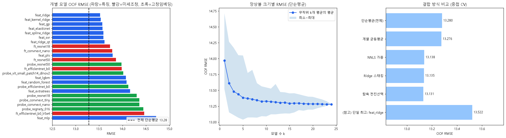
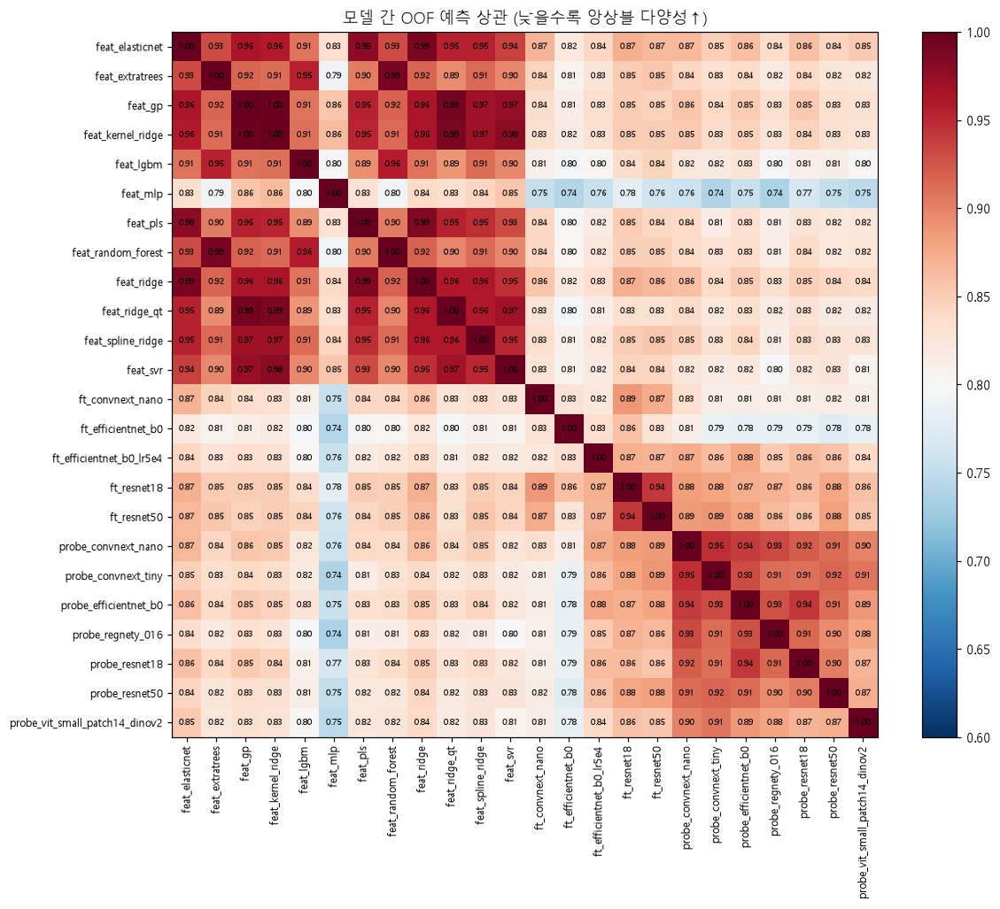

# 모델 카탈로그 & 다중 모델 앙상블 검토

> 작성일: 2026-10-03 · 평가 기준: 고정 5-Fold(`outputs/folds.csv`) OOF RMSE (낮을수록 좋음), 평균 예측 = 17.68
> 재현: `src/feature_models.py`, `src/train_cnn.py`, `src/probe_embeddings.py`, `src/ensemble_analysis.py`
> 결과 원본: `outputs/ensemble_analysis.json`, `outputs/feat_*/`, `outputs/cnn/*/`, `outputs/probe/*/`

---

## 0. 요약

| 질문 | 답 |
|---|---|
| 어떤 모델 종류가 있나? | 입력 기준으로 **① 수작업 특징 기반 ② 고정 임베딩 기반 ③ CNN 미세조정 ④ (미시험) ViT·하이브리드·전용 CNN**. 총 24개 변형을 실측 (§1) |
| 단일 모델 최고는? | **수작업 특징 + Ridge 13.52**. 상위 7개가 모두 특징 기반 선형·커널 모델이며 13.52~13.61로 거의 같음 |
| 여러 모델 앙상블이 효과 있나? | **있다.** 단일 13.52 → 앙상블 **13.03 (−0.49)**. 개별 평균 오차 13.97 중 다양성 효과로 0.7 감소 |
| 어떻게 결합하나? | **계열별 대표를 골라 단순 평균**(조합 C). 가중치 학습(NNLS·스태킹·탐욕 선택 13.13~13.14)은 500장에서 이득이 없음 |
| 몇 개가 적당한가? | 개선은 **5~8개**에서 대부분 끝남. 다양한 계열 5~6개 블록 + 블록 내부 시드 평균이 효율적 |
| 시드 앙상블은? | ResNet-18 시드 3개 평균 13.80 → **13.66 (−0.14)**. 미세조정 CNN에는 필수 |

---

## 1. 모델 카탈로그

### 1.1 실측 결과 (24개 변형)

| 계열 | 모델 | OOF RMSE | 학습 비용 (노트북) | 특징 |
|---|---|---|---|---|
| **A. 특징 + 선형** | **Ridge** | **13.52** | 수 초 (CPU) | 단일 최고, 해석 가능, 안정 |
| | ElasticNet | 13.58 | 수 초 | L1로 특징 선택. Ridge와 거의 동일 |
| | Spline-Ridge (GAM형 비선형) | 13.59 | 수 초 | 특징별 비선형 허용 → 이득 없음 (관계가 준선형) |
| | Ridge (분위수 변환) | 13.61 | 수 초 | |
| | PLS | 13.79 | 수 초 | 성분 수 제한으로 정보 손실 |
| **B. 특징 + 커널** | **Kernel Ridge (RBF)** | **13.54** | 수십 초 | Ridge와 비슷하지만 오류 패턴이 약간 다름 |
| | **Gaussian Process** | **13.57** | 수십 초 | 불확실성 추정 가능 |
| | **SVR (RBF)** | **13.59** | 수십 초 | |
| **C. 특징 + 트리** | LightGBM | 14.07 | 5초 | 500장·공선성 큰 특징에서 불리 |
| | RandomForest | 14.09 | 79초 | |
| | ExtraTrees | 14.16 | 7초 | |
| **D. 특징 + 신경망** | MLP (64 은닉) | 14.72 | 1초 | 데이터 부족으로 최하위 |
| **E. 고정 임베딩 + Ridge** | **ResNet-50** | **13.98** | 74초 (GPU 추론) | 가장 싼 이미지 모델, 독립적인 오류 |
| | **DINOv2 ViT-S/14** | **14.02** | 135초 | 자기지도 학습 표현, 다른 계열과 낮은 상관 |
| | EfficientNet-B0 | 14.13 | 75초 | |
| | ResNet-18 | 14.30 | 26초 | |
| | ConvNeXt-Tiny / Nano | 14.36 / 14.36 | 61 / 147초 | |
| | RegNetY-016 | 14.44 | 126초 | |
| **F. CNN 미세조정** | **ResNet-18** (시드 42/43/44) | 13.73 / 13.84 / 13.84 → **3시드 평균 13.66** | 6~10분/시드 | 빠름 → 실험 테스트베드 |
| | **ConvNeXt-nano** (lr 3e-4) | **13.78** | 11분 | 구조 다양성, 폴드 간 편차 최소 |
| | ResNet-50 | 13.86 | 11분 | ResNet-18과 상관 0.94 (중복) |
| | **EfficientNet-B0** (lr 1e-3) | **13.98** | 15분 | fold 2만 초기 발산, 나머지 4폴드는 최고 수준 |
| | EfficientNet-B0 (lr 5e-4) | 14.46 | 21분 | 낮은 lr은 과소적합 → **lr 1e-3 + warmup 연장**이 올바른 해법 |

### 1.2 아직 시험하지 않은 후보

| 계열 | 모델 | 기대 효과 | 비용·위험 | 우선순위 |
|---|---|---|---|---|
| **G. 하이브리드 CNN** | CNN 임베딩 + 수작업 특징을 헤드에서 결합 (end-to-end) | 두 정보원을 한 모델이 직접 결합 | 구현 1~2시간, 학습은 CNN과 동일 | **높음** |
| **H. 멀티태스크 CNN** | 경도 + 보조 타깃(2상 분율, 정렬도 등 수작업 특징)을 동시에 예측 | 500장으로도 "측정 능력"을 배우도록 유도 | 구현 1시간 | **높음** |
| I. ViT 미세조정 | DINOv2 ViT-S/14 (낮은 lr, layer-wise lr decay) | 프로브 2위 → 미세조정 시 다양성 기대 | 별도 레시피 탐색 필요 | 중 |
| J. 전용 경량 CNN | 사전학습 없이 얕은 CNN + 평균·표준편차 풀링 | 합성 이미지에 맞춘 설계, 매우 빠름 | 데이터 500장으로 일반화 불확실 | 중~낮 |
| K. AutoML / TabPFN | 특징 테이블 자동 모델링 | 특징 기반 모델 상한 확인 | 규칙상 AutoML은 허용, **TabPFN 등은 가중치 라이선스 확인 필요** | 낮음 |

> 모든 사전학습 가중치는 대회 규칙(허용 라이선스)을 지켜야 한다. 현재 사용 중인 timm 가중치는 모두 Apache-2.0 또는 BSD-3-Clause.

### 1.3 계열별 관찰

- **특징 기반 선형·커널(A·B)이 단일 모델 상위를 차지**한다. 특징과 경도의 관계가 준선형이고, 500장에서는 단순한 모델이 분산이 작다.
- 트리·MLP(C·D)는 일관되게 나쁘다 → 앙상블 블록에서 제외.
- CNN(F)은 단일 성능이 특징 모델보다 0.2~0.5 낮지만, **특징 모델과 상관이 0.82~0.87로 낮아** 앙상블 기여가 크다.
- 고정 임베딩(E)은 수십 초~2분으로 가장 싸게 다양성을 더하는 수단이다.

---

## 2. 다중 모델 앙상블 검토



*왼쪽: 24개 모델 개별 성능 (파랑=특징, 빨강=미세조정, 초록=고정 임베딩). 가운데: 무작위 k개를 단순 평균했을 때의 성능 곡선. 오른쪽: 결합 방식 비교 (중첩 CV).*

### 2.1 왜 효과가 있는가 — 다양성 분해

24개 모델을 동일 가중 평균하면 다음과 같다 (Krogh & Vedelsby 분해):

| 항목 | 값 |
|---|---|
| 개별 모델 평균 MSE | 195.2 (RMSE 13.97) |
| − 평균 모호도(모델 간 의견 차이) | 18.9 |
| = 앙상블 MSE | 176.4 (RMSE **13.28**) |

모델들이 **서로 다르게 틀리는 만큼** 오차가 줄어든다. 이 데이터는 라벨 잡음이 크고 표본이 적어 개별 모델의 분산이 크므로, 앙상블이 특히 유리한 조건이다.



*모델 간 OOF 예측 상관. 같은 계열 내부는 중복이 크다(선형·커널 특징 모델끼리 0.94~1.00, 프로브끼리 0.87~0.95). 계열 간(특징↔미세조정 CNN)은 0.74~0.87로 낮다 → **계열을 섞어야 효과가 난다.***

### 2.2 몇 개를 섞어야 하나 — 크기별 곡선

| 모델 수 k | 1 | 2 | 3 | 5 | 8 | 10 | 15 | 24 |
|---|---|---|---|---|---|---|---|---|
| 무작위 k개 평균 RMSE | 13.97 | 13.61 | 13.48 | 13.38 | 13.34 | 13.33 | 13.29 | 13.28 |

- 개선의 대부분이 **처음 5개에서** 나온다. 그 뒤로는 거의 평탄하다.
- 무작위 조합보다 **계열이 다른 모델을 고른 조합**이 더 좋다. 무작위 5개 조합 300개 중 최저가 13.04였고, 계열별 대표 조합(C)도 13.03이다.

### 2.3 결합 방식 비교 (모두 중첩 CV — 가중치를 다른 폴드에서 추정)

| 방식 | OOF RMSE | 평가 |
|---|---|---|
| 24개 단순 평균 | 13.28 | 비슷한 모델 다수(특징 8개, 프로브 7개)가 과대 반영 |
| 계열 3개 균등 평균 (24개 전부 사용) | 13.28 | 약한 모델(트리·MLP·약한 프로브)까지 포함되어 희석 |
| NNLS 비음수 가중 | 13.14 | |
| Ridge 스태킹 | 13.14 | |
| 탐욕 전진 선택 (Caruana) | 13.13 | |
| **A.** Ridge + CNN 4종 단순 평균 (**제출 v1**, LB 12.33) | 13.13 | |
| **B.** Ridge + CNN 3종 (ResNet-50 제외) | 13.09 | 중복 모델 제거 효과 |
| **C.** Ridge + 커널 3종 평균 + CNN 3종(ResNet-18은 3시드 평균) + 프로브 2종 평균 → **6블록 단순 평균** | **13.03** | **최고** |
| **D.** 계열 균등: 특징(2블록) / CNN(3블록) / 프로브 | 13.08 | |

**결론**
- 가중치를 학습하는 방식은 단순 평균을 이기지 못한다. 500장 OOF로 가중치 20여 개를 추정하면 그 자체가 잡음이 되기 때문이다.
- **"좋은 계열 대표를 고르고(선택), 블록 안에서 시드·변형을 평균하고(분산 감소), 블록끼리 단순 평균"**하는 계층형 구조가 가장 좋다.
- 주의: 조합 A~D는 OOF 결과를 본 뒤 설계한 것이라 약간의 선택 편향이 있다(후보 4개 수준이라 작음). 다음 제출의 LB로 교차 확인한다.

### 2.4 시드 앙상블 (같은 모델, 다른 난수)

| 모델 | 시드별 단독 | 시드 3개 평균 | 시드 간 상관 |
|---|---|---|---|
| ResNet-18 | 13.73 / 13.84 / 13.84 (평균 13.80) | **13.66 (−0.14)** | 0.961 |

- 시드 간 상관이 0.96으로 1이 아니다. 미세조정 CNN은 **난수만 바꿔도 예측이 꽤 달라진다**(500장 데이터의 높은 분산).
- 시드 평균은 구조를 바꾸지 않고 얻는 **가장 확실한 개선**이다. 채택한 CNN마다 3시드를 권장한다.

### 2.5 앙상블의 3개 층위 (권장 구조)

```
[층위 1] 모델 내부 평균 ─ D4 TTA 8방향 × 5개 폴드 모델 (이미 적용)
          └ 이 효과 덕분에 test 예측이 OOF보다 좋게 나온다 (v1: CV 13.13 → LB 12.33)
[층위 2] 블록 내부 평균 ─ 같은 모델의 시드 3개 / 같은 계열의 유사 모델 (예: 커널 3종)
[층위 3] 블록 간 단순 평균 ─ 계열이 다른 대표 블록 5~6개
```

### 2.6 위험 요소와 대응

| 위험 | 내용 | 대응 |
|---|---|---|
| CV 과적합 | OOF를 보며 조합·가중치를 반복 조정하면 CV가 낙관적으로 됨 | 가중치 학습 지양, 조합 후보 최소화, **중첩 CV로만 평가** |
| Public LB 과적합 | 300장 LB(표본오차 ±0.56)를 보고 고르면 Private에서 하락 위험 | **CV 기준 선택**, LB는 정합 확인용 |
| 재현성 (2차 코드 검증) | "Private Score 복원 가능"해야 함. 모델 수가 늘수록 재학습 시간·비결정성 증가 | 시드 고정, **폴드별 가중치 저장**, 학습/추론 스크립트 분리, 모델 수를 블록 5~6개로 제한 |
| 실행 시간 | 검증자가 전체 파이프라인을 재실행할 수 있어야 함 | 예상 총 학습 시간 명시 (아래 예산) |
| GPU 비결정성 | cuDNN 자동튜닝으로 재실행 시 소수점 차이 | 저장한 가중치로 추론 재현 + 재학습 시 오차 범위 문서화 |

### 2.7 학습 예산 (노트북 기준, 5-Fold)

| 블록 | 구성 | 학습 시간 |
|---|---|---|
| 특징 Ridge / 커널 3종 | CPU | 1분 미만 |
| 고정 프로브 (ResNet-50, DINOv2) | 추론만 | 약 4분 |
| ResNet-18 × 3시드 | 미세조정 | 약 20~30분 |
| ConvNeXt-nano × 3시드 | 미세조정 | 약 35분 |
| EfficientNet-B0 × 3시드 | 미세조정 | 약 45분 |
| **합계** | | **약 2시간** (Colab T4를 병렬로 쓰면 약 1시간) |

---

## 3. 권장안

### 3.1 최종 앙상블 후보 구성 (조합 C 기반)

| 블록 | 내용 | 현재 상태 |
|---|---|---|
| ① 특징-선형 | Ridge | ✅ |
| ② 특징-커널 | Kernel Ridge + GP + SVR 평균 | ✅ |
| ③ CNN-ResNet | ResNet-18 × 3시드 | ✅ |
| ④ CNN-ConvNeXt | ConvNeXt-nano × 3시드 | 1시드 → **2시드 추가** |
| ⑤ CNN-EfficientNet | EfficientNet-B0 (lr 1e-3, warmup 3에폭) × 3시드 | 1시드(fold 2 발산) → **수정 후 재학습** |
| ⑥ 이미지-프로브 | ResNet-50 + DINOv2 임베딩 Ridge 평균 | ✅ |
| (후보) ⑦ 하이브리드/멀티태스크 CNN | §1.2 G·H | 미시험 → 효과 있으면 블록 추가 |

결합: **6블록 단순 평균** (가중치 학습 없음). 현재 CV **13.03** — `submissions/sub_v2_curated_C.csv` (v1과 예측 상관 0.994)

### 3.2 다음 순서 제안

1. `sub_v2_curated_C.csv` 제출 → v1(LB 12.33)과 비교해 CV 개선(−0.09)이 LB에서도 같은 방향인지 확인
2. EfficientNet-B0 warmup 수정 + ConvNeXt·EfficientNet 시드 추가 (약 1.5시간, 백그라운드)
3. 3단계 증강 실험 (ResNet-18 테스트베드) → 좋은 증강을 모든 CNN 블록에 적용
4. 하이브리드/멀티태스크 CNN 시험 (§1.2 G·H)
